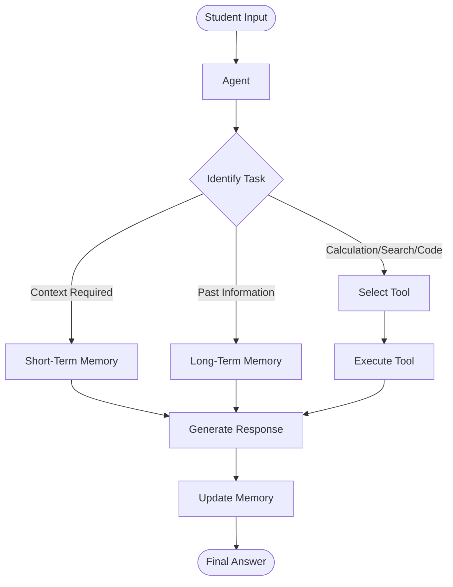

# AI Agent with Memory and Tools

## 📌 Project Overview

This project demonstrates an AI agent that can remember information across conversations, retrieve previously stored facts, and use external-style tools to perform tasks.

The system is developed using Python and demonstrates the importance of short-term memory, long-term memory, similarity-based retrieval, and tool integration in intelligent agents.

The agent can remember student information, answer questions based on previous conversations, perform calculations, search academic information, and execute simple Python code in a restricted environment.

The project also compares different agent configurations to understand how memory and tool access improve task performance.

## 🎯 Objectives

- Understand the difference between short-term and long-term memory.
- Implement a short-term conversation buffer.
- Implement a long-term memory store with similarity-based retrieval.
- Use TF-IDF and cosine similarity to retrieve relevant information.
- Integrate tools such as calculator, search, date calculation, and code execution.
- Maintain context across multiple sessions.
- Compare a memoryless agent with agents having different memory and tool configurations.

## 🧠 Memory Architecture

The project implements two types of memory.

### 1. Short-Term Memory

Short-term memory stores recent interactions within the current conversation.

**Implementation:** Python `deque` with a maximum buffer size of 4 turns.

It helps the agent understand references such as:
- Double that.
- Subtract 80 from it.
- Continue from the previous result.

For example:

Student: What is 45 × 12?

Agent: 540

Student: Double that.

Agent: 1080

The agent uses its short-term memory to understand what "that" refers to.

### 2. Long-Term Memory

Long-term memory stores important statements so they can be retrieved in future sessions.

**Implementation:** A custom `VectorStore` class using TF-IDF and cosine similarity.

The memory is stored as text and sequence numbers and can be saved and loaded using JSON.

Example:

Student: My exam is on 12 December.

Student: I study 3 hours every day.

Student: My favourite subject is machine learning.

In a new session, the agent can still answer questions such as:

- When is my exam?
- How many hours do I study per day?
- What is my favourite subject?

The system also considers newer information when facts are updated.

**Note:** This project implements a lightweight similarity-based vector store using TF-IDF and cosine similarity. It does not use an external vector database or neural embedding model.

## 🛠️ Tools Integrated

The agent uses four main tool categories.

| Tool | Purpose |
|---|---|
| Calculator | Performs arithmetic calculations using a restricted Python AST evaluator. |
| Search Tool | Retrieves relevant information from a predefined academic knowledge corpus. |
| Date Tool | Calculates the number of days remaining until an exam. |
| Code Execution Tool | Executes simple Python code inside a restricted demonstration sandbox. |

### 1. Calculator Tool

The calculator supports:
- Addition
- Subtraction
- Multiplication
- Division
- Exponentiation

Example:

Input: `45 * 12`

Output: `540`

### 2. Search Tool

The search tool retrieves information from a small predefined knowledge corpus.

Example:

Input: `Search: what is overfitting?`

Output: Overfitting happens when a model learns the training data too well, including its noise, and then performs poorly on new data.

### 3. Date Tool

The date tool retrieves an exam date from memory and calculates the remaining days.

Example:

Exam date: 15 December 2026

Demo date: 1 December 2026

Output: 14 days remaining.

### 4. Code Execution Tool

The agent can execute simple Python code using restricted built-in functions.

Example:

Input:

```python
print(sum(range(1, 11)))
```

Output:

```text
55
```

The code execution tool blocks potentially unsafe operations such as imports, file access, and infinite loops.

## 🔄 Agent Workflow

1. The agent receives a student message.
2. It checks whether the question requires memory or a tool.
3. It searches the short-term buffer for recent context.
4. If required, it retrieves relevant facts from long-term memory.
5. It selects an appropriate tool such as calculator, search, date, or code execution.
6. It processes the tool result and generates an answer.
7. It stores new statements in long-term memory.
8. The process continues across multiple interactions and sessions.

### Workflow Diagram



## 🧪 Experiments and Evaluation

The project compares five different agent configurations.

| Configuration | Memory / Tools |
|---|---|
| C0 – Baseline | No memory and no tools |
| C1 – Short-Term Only | Short-term memory |
| C2 – Memory Agent | Short-term and long-term memory |
| C3 – Tools Only | Calculator, search, date, and code tools |
| C4 – Full Agent | Short-term memory, long-term memory, and tools |

Each configuration is tested against 17 questions across two sessions.

### Performance Results

The following results were obtained by executing the notebook.

| Agent Configuration | Correct Answers | Accuracy |
|---|---:|---:|
| C0 – Baseline | 3/17 | 18% |
| C1 – Short-Term Only | 4/17 | 24% |
| C2 – Short + Long-Term | 8/17 | 47% |
| C3 – Tools Only | 7/17 | 41% |
| C4 – Full Agent | 16/17 | 94% |

### Accuracy Comparison

The full agent performs significantly better because it combines memory retrieval with tool usage.

```text
Baseline          18%  ████
Short-Term        24%  █████
Memory Agent      47%  █████████
Tools Only        41%  ████████
Full Agent        94%  ███████████████████
```

**Observation:** The combination of short-term memory, long-term memory, and tools provides the best performance in the tested scenarios.

## 🔍 Long-Term Memory Retrieval

The project uses a similarity threshold of 0.35 to decide whether a retrieved memory is relevant enough to use.

The system also uses a recency window of 0.15 to prefer newer facts when multiple similar memories are available.

For example:

Old information: My exam is on 12 December.

Updated information: My exam moved to 15 December.

The agent retrieves the newer information when asked about the exam date.

If the similarity score is too low, the agent responds with "I don't know" rather than guessing.

## ⚠️ Failure Analysis and Limitations

One limitation identified during testing is paraphrased question retrieval.

Example:

Stored information: My exam is on 15 December.

Question: When do I sit for my paper?

Expected: 15 December.

Actual: I don't know.

**Reason:** The simple TF-IDF similarity mechanism does not always recognize questions that use different words to express the same meaning.

**Possible improvement:**
- Use semantic embeddings instead of only word-based similarity.
- Integrate a dedicated vector database such as FAISS or ChromaDB.
- Improve query preprocessing and synonym handling.

Another important observation is that the short-term buffer size affects how much previous context the agent can retain.

The default buffer size is four turns. In the experiment, a buffer size of ten or more was needed to retain the exam statement until turn eleven without long-term memory.

## 🔐 Safety and Security

The project includes basic safety measures for tool usage.

- Calculator operations are restricted to approved mathematical operators.
- Code execution uses an allowlist of built-in functions.
- Imports and file access are blocked.
- Code length is limited to 200 characters.
- Potentially unsafe operations and large exponent expressions are rejected.
- Errors are handled without exposing detailed internal tracebacks.

**Important:** The code execution sandbox is designed for demonstration and learning purposes. It is not a production-grade security boundary.

## 💻 Technologies Used

- Python – Main programming language.
- TF-IDF – Text-based memory representation.
- Cosine Similarity – Similarity-based memory retrieval.
- JSON – Long-term memory persistence.
- AST – Safe mathematical expression evaluation.
- Jupyter Notebook – Development and experimentation environment.
- Python Libraries – `re`, `json`, `math`, `ast`, `io`, `operator`, `collections`, and `datetime`.

## ⚙️ Installation and Execution

### 1. Clone the Repository

```bash
git clone https://github.com/your-username/memory-and-tools-agent.git
```

### 2. Navigate to the Project Folder

```bash
cd memory-and-tools-agent
```

### 3. Install Required Libraries

```bash
pip install notebook
```

The project primarily uses Python's built-in libraries, so no external AI API or vector database installation is required.

### 4. Open the Notebook

```bash
jupyter notebook
```

Open:

`Memory_and_Tools_Agent.ipynb`

### 5. Run All Cells

Execute the notebook from beginning to end.

The notebook will:
- Initialize the agent and its memory modules.
- Demonstrate short-term memory.
- Demonstrate long-term memory across sessions.
- Execute calculator, search, date, and code tools.
- Compare five different agent configurations.
- Display accuracy results.
- Test memory retrieval thresholds and buffer sizes.
- Perform basic code execution safety tests.

## 📁 Project Structure

```text
Memory-and-Tools-Agent/
│
├── Memory_and_Tools_Agent.ipynb
└── README.md
```

## 🎓 Learning Outcomes

Through this project, I learned:

- How short-term and long-term memory work in AI agents.
- How to maintain conversation context across multiple sessions.
- How TF-IDF and cosine similarity support information retrieval.
- How to integrate tools into an agent's response workflow.
- How memory and tools improve task performance.
- How to compare different agent configurations using accuracy.
- How to implement basic restrictions on code execution and tool usage.

## ⚠️ Limitations

- Memory retrieval uses a simple TF-IDF approach rather than semantic embeddings.
- The vector store is custom-built and stored in JSON.
- Search works on a predefined local knowledge corpus, not the live internet.
- Code execution is restricted to a demonstration environment.
- The date tool uses a fixed demo date of 1 December 2026 to ensure repeatable results.
- The system uses programmed decision logic rather than a live LLM.

## 👨‍💻 Author

**Project:** AI Agent with Memory and Tools  
**Topic:** Unit III – Memory, Tools, and Environment Interaction  
**Course Outcome:** CO III  
**Language:** Python  
**Environment:** Jupyter Notebook / Google Colab

Developed as an academic activity to demonstrate memory management, similarity-based retrieval, tool integration, and agent performance evaluation.
